# ภาพสาธิตการใช้งาน KPOP STORE

แผนสำรองสำหรับการนำเสนอ — ถ้าเว็บจริงเปิดไม่ได้ ใช้หน้านี้เล่าการทำงานแทนได้ครบทุกขั้น

- เว็บจริง: https://web-production-6fbe4.up.railway.app
- ภาพทั้งหมดเล่นจริงทีละขั้นผ่านเบราว์เซอร์บน Docker ในเครื่อง ด้วย**ข้อมูลตัวอย่าง** (`database/kpop_store.sql`) ไม่มีข้อมูลลูกค้าจริง
- สลิปในภาพเป็นภาพตัวอย่างที่สร้างขึ้นเพื่อสาธิต ไม่ใช่หลักฐานการโอนจริง
- ตัวอย่างในภาพ: ลูกค้าสั่ง aespa 2 ชิ้น ยอดสุทธิ ฿1,762 (₩24,500 × เรทราคากลาง 0.028 + ค่าบริการ ฿170 = ฿856/ชิ้น × 2 ชิ้น = ฿1,712 + ค่าส่งในไทย ฿50) → แอดมินอนุมัติสลิป → เปลี่ยนสถานะเป็นกำลังจัดส่งพร้อมเลขพัสดุ

## ฝั่งลูกค้า: เลือกสินค้า → สั่งซื้อ → แนบสลิป

### 1. หน้าแรก: แคตตาล็อกสินค้าพรีออเดอร์ แยกตามรอบ พร้อมป้ายวันปิดรับ ราคาคิดจากเรทราคากลาง

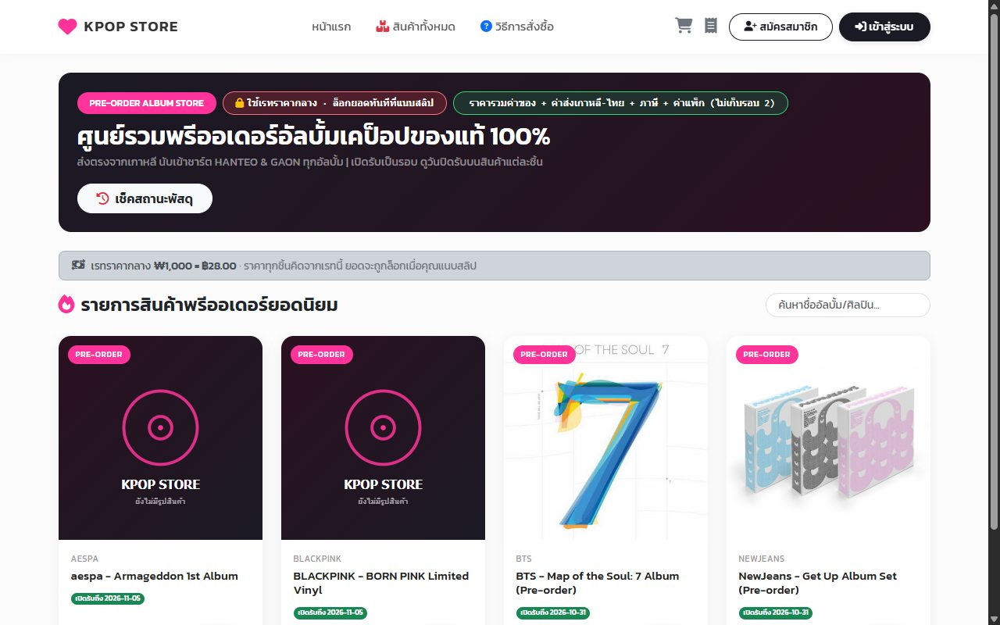

### 2. เข้าสู่ระบบ (รหัสผ่านตรวจจริงด้วย password_verify ในฝั่ง PHP)

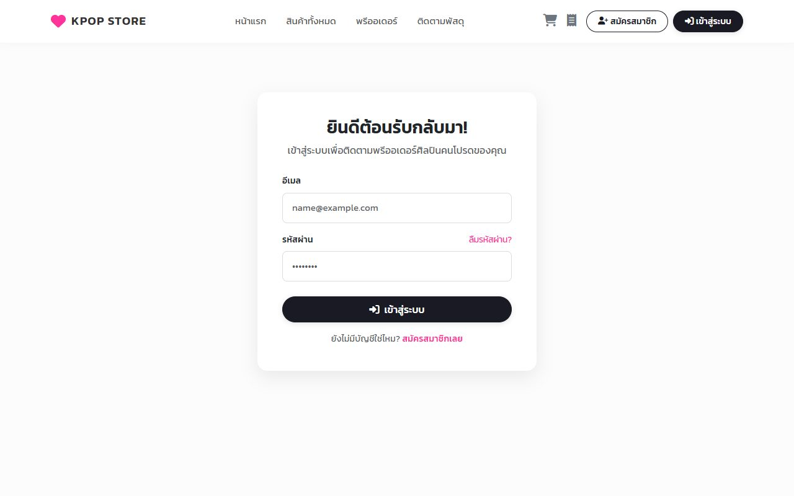

### 3. รายละเอียดสินค้า: ราคาแยกที่มา (ราคาวอน × เรทราคากลาง + ค่าบริการ), รอบพรีออเดอร์ และนับถอยหลังวันปิดรับ

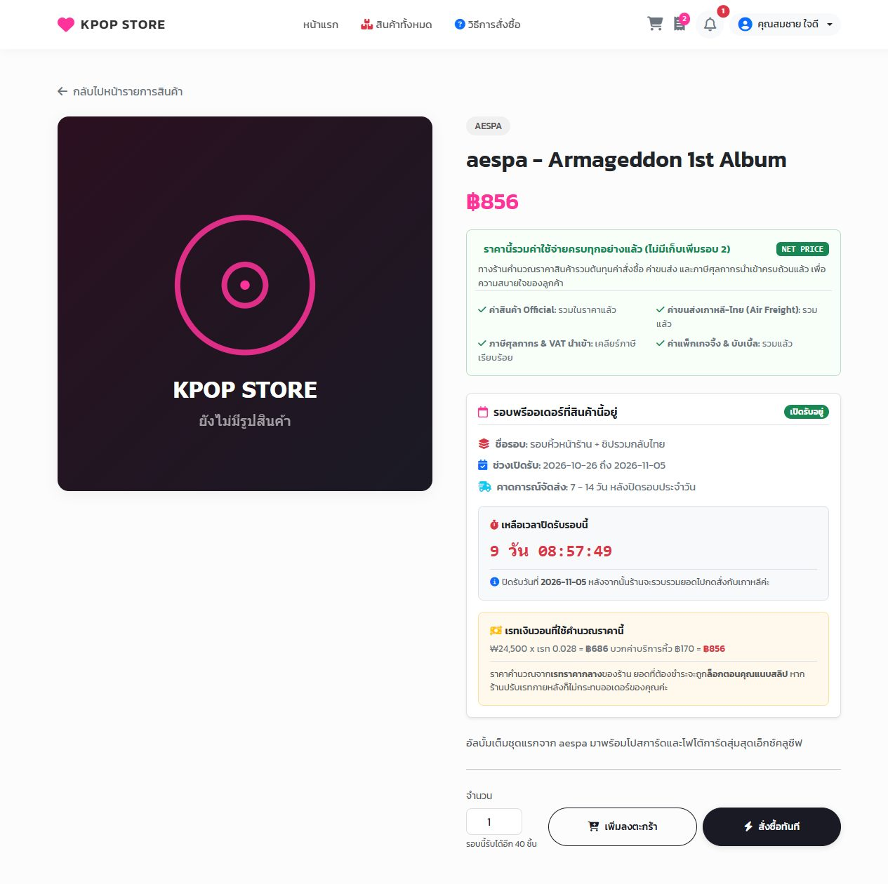

### 4. ตะกร้า: แยกกลุ่มตามรอบพรีออเดอร์ (ของคนละรอบถึงไทยคนละเวลา จึงคิดค่าส่งแยกรอบ)

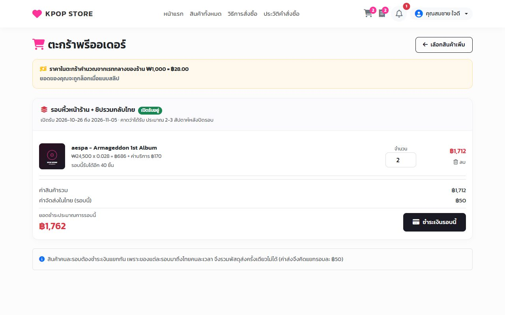

### 5. ชำระเงิน: สรุปยอด แนบสลิปโอนเงิน (ระบบย่อรูปก่อนอัปโหลด) และยอมรับเงื่อนไข — ยอดถูกล็อกที่เรทนี้ทันทีที่ยืนยัน

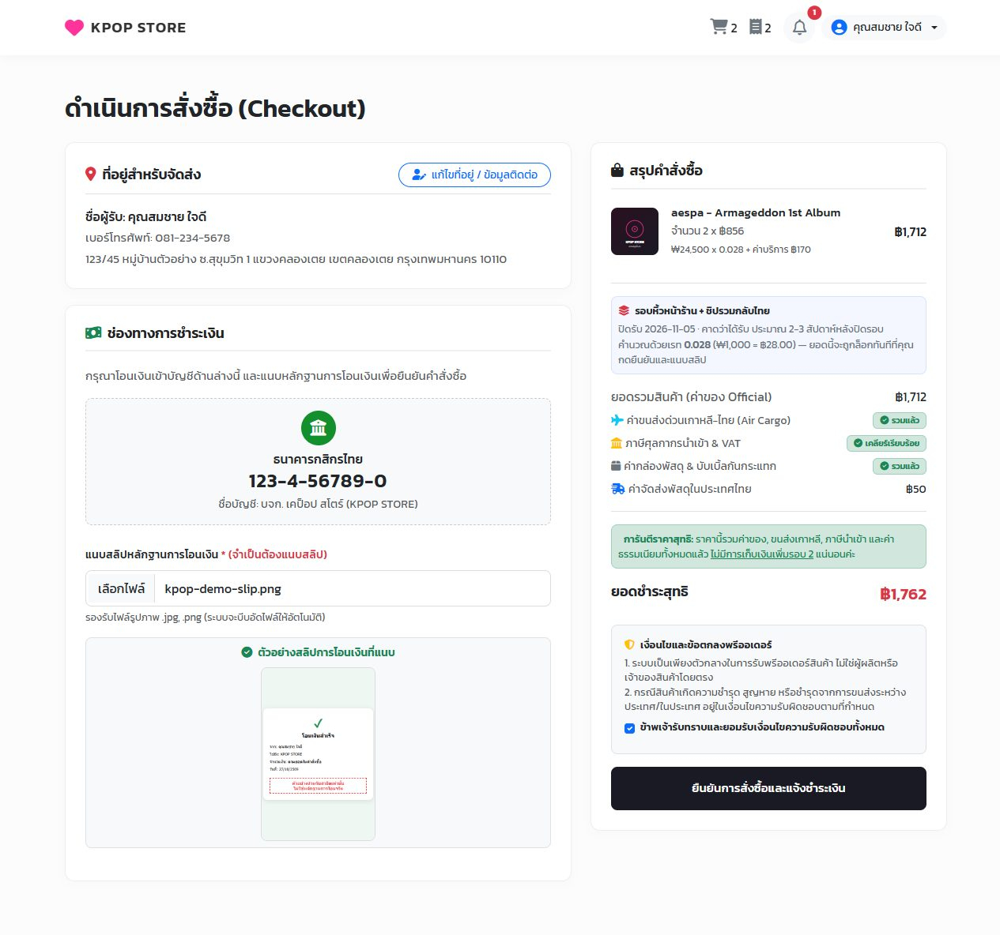

### 6. ประวัติคำสั่งซื้อ: ออเดอร์ใหม่อยู่สถานะ "รอตรวจสอบสลิป" ลูกค้ายกเลิกเองได้ในสถานะนี้

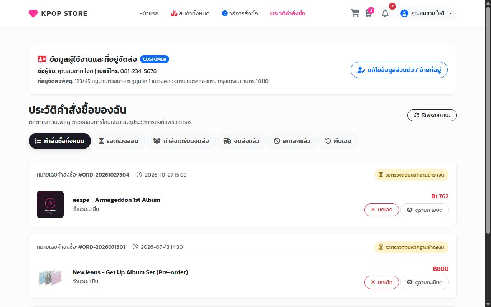

## ฝั่งแอดมิน: ตรวจสลิป → อนุมัติ → อัปเดตการจัดส่ง

### 7. หลังบ้าน: Dashboard ยอดขาย สลิปรอตรวจ และยอดสั่งรายวันต่อสินค้า

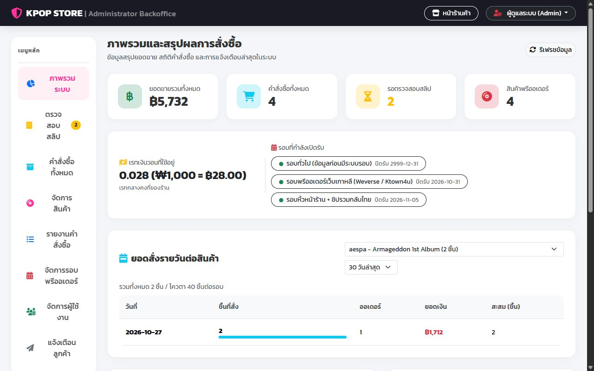

### 8. แท็บตรวจสลิป: รายการที่รออนุมัติ

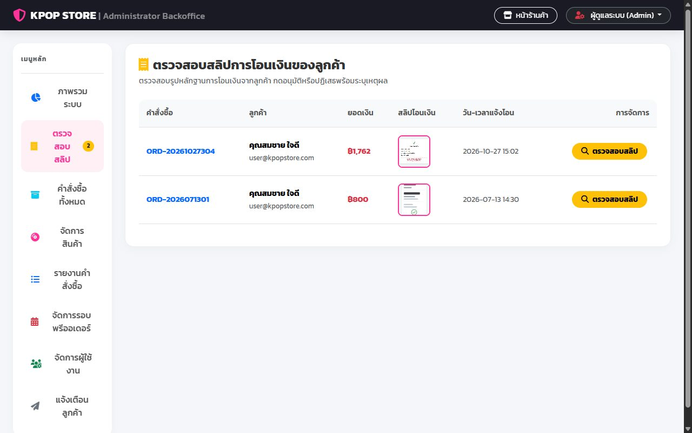

### 9. เปิดดูสลิปเทียบกับยอดก่อนอนุมัติ (ออเดอร์ที่ไม่มีสลิปกดอนุมัติไม่ได้)

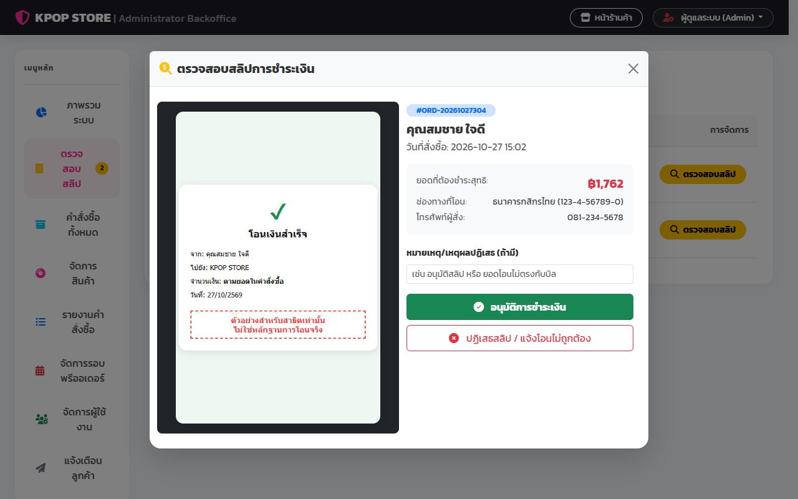

### 10. อัปเดตสถานะเป็น "กำลังจัดส่ง" พร้อมเลขพัสดุ (สถานะเป็นข้อมูลแบบตาราง flag ไม่ใช่ข้อความ)

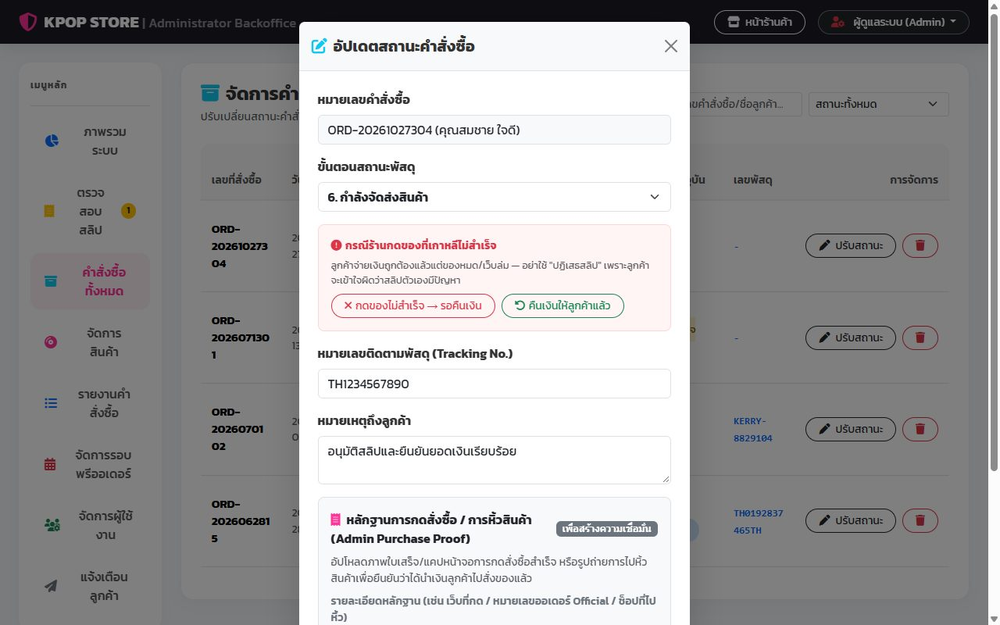

### 11. แท็บคำสั่งซื้อหลังอัปเดต

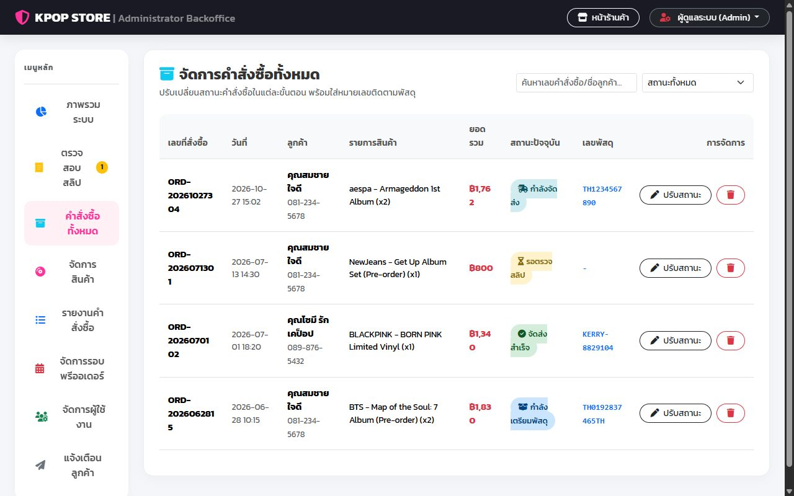

### 12. แท็บรายงาน: คำสั่งซื้อต่อสินค้า (export เป็น Excel ได้)

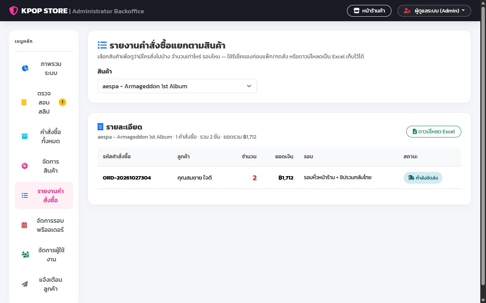

## ลูกค้าเห็นสถานะใหม่

### 13. ลูกค้าเห็นสถานะ "กำลังจัดส่ง" และเลขพัสดุ พร้อมการแจ้งเตือนในเว็บ

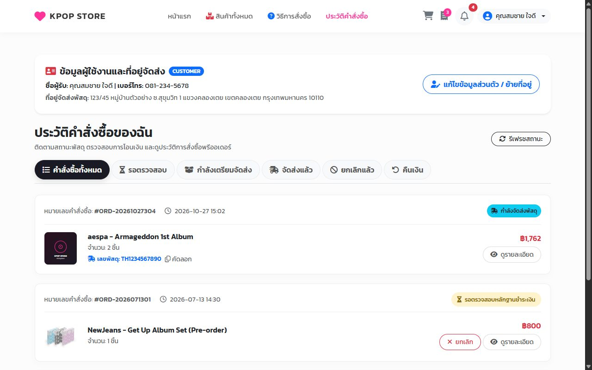

## จอมือถือ

### 14. จอมือถือ: หน้าแรก + แถบเมนูล่าง

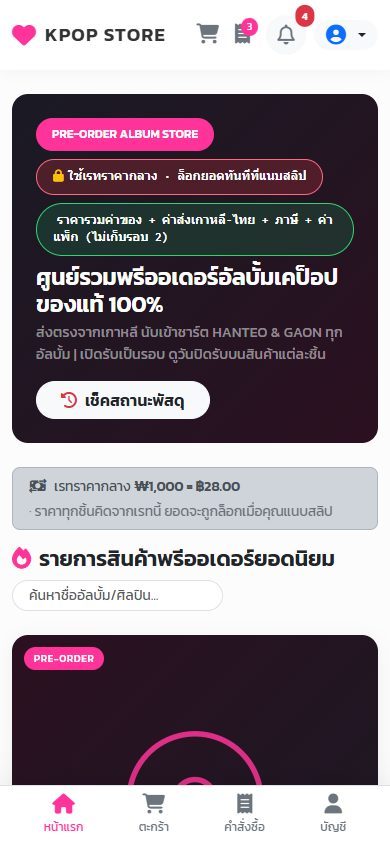

### 15. จอมือถือ: ประวัติคำสั่งซื้อ

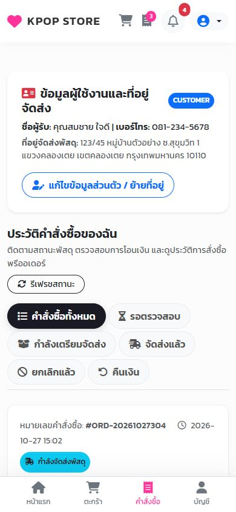

---

ภาพชุดนี้ถ่ายเมื่อ ต.ค. 2026 — การทดสอบอัตโนมัติของเว็บที่รันอยู่จริงดูได้ที่ [docs/TESTING.md](../TESTING.md) หัวข้อ 4C
